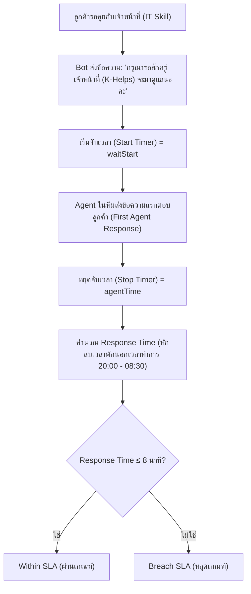
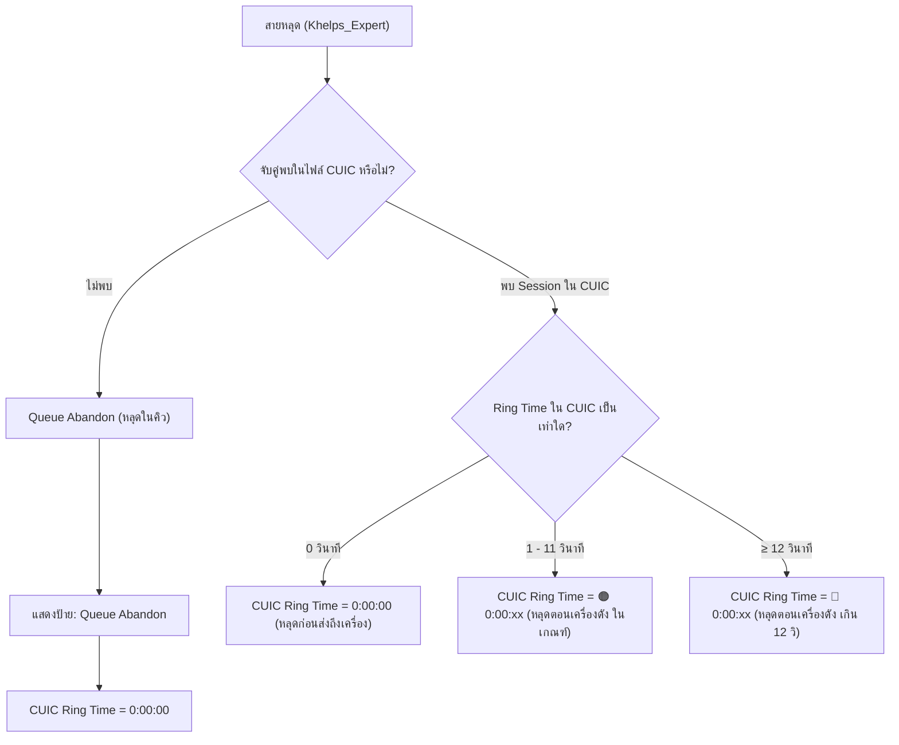
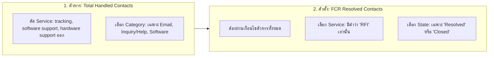

# คู่มือและสูตรการคำนวณ K-Helps Analytics Center (SLA & Performance Manual)

เอกสารฉบับนี้อธิบายที่มาของข้อมูล เกณฑ์การคัดกรอง (Filters) เงื่อนไขการคำนวณ (Business Logic) และสูตรคณิตศาสตร์ที่ใช้ในแต่ละแท็บ (Module) ของระบบ **K-Helps Analytics Center** ไว้อย่างละเอียด

---

## สารบัญโมดูลทั้งหมด
1. [Module 1: First Response ECE By Agents (Chat SLA)](#module-1-first-response-ece-by-agents-chat-sla)
2. [Module 2: % Within SLA of 16 Apps (Task SLA)](#module-2--within-sla-of-16-apps-task-sla)
3. [Module 3: Call Not Received (Within 12 Secs) (CUIC Call Report)](#module-3-call-not-received-within-12-secs-cuic-call-report)
4. [Module 4: Call Back (ABN Call of Ex) (Abandoned Calls vs CUIC)](#module-4-call-back-abn-call-of-ex-abandoned-calls-vs-cuic)
5. [Module 5: %FCR (Target > 90%) (First Contact Resolution)](#module-5-fcr-target--90-first-contact-resolution)

---

## Module 1: First Response ECE By Agents (Chat SLA)

### 1. วัตถุประสงค์
วัดประสิทธิภาพการตอบรับแชทครั้งแรก (**First Response Time**) ของเจ้าหน้าที่ Agent ในทีมผ่านช่องทาง LINE / ECE Chat โดยดูว่าสามารถเข้ามารับแชทและตอบข้อความแรกได้ทันตามเกณฑ์เวลาทำการหรือไม่

### 2. แหล่งที่มาของข้อมูล (Data Source)
* ไฟล์รายงานการสนทนา LINE / ECE: `Line_K4W_TRANSACTION_REPORT.xlsx`
* คอลัมน์สำคัญ: `session_id`, `date`, `time`, `source`, `agent_skill`, `message_text`, `agent_name`

### 3. แผนภาพและขั้นตอนการทำงาน (Workflow)

### 4. สูตรและเงื่อนไขการคำนวณ
1. **จุดเริ่มนับเวลา (Start Timer):**
   * ข้อความจาก Bot (`source == 'bot'`)
   * ทักษะงาน IT (`agent_skill == 'IT'`)
   * มีข้อความมาตรฐาน: `"กรุณารอสักครู่ เจ้าหน้าที่ (K-Helps) จะมาดูแลนะคะ"`
2. **จุดหยุดเวลา (Stop Timer):**
   * ข้อความแรกจาก Agent ในทีม (`source == 'agent'` และตรงกับรายชื่อ Valid Team Agents)
3. **การคำนวณเวลาทำการ (Business Operating Hours):**
   * นับเฉพาะเวลาทำการ **08:30 น. - 20:00 น.**
   * หากลูกค้ารอข้ามคืน ช่วงเวลา 20:00 - 08:30 น. จะถูกหยุดเวลา (Pause) ไม่นำมาคิดเป็นเวลารอ
4. **สูตรคำนวณ % Within SLA:**
   $$\% \text{Within SLA} = \left( \frac{\text{จำนวนแชทที่ตอบภายใน 8 นาที}}{\text{จำนวนแชททั้งหมด}} \right) \times 100$$

---

## Module 2: % Within SLA of 16 Apps (Task SLA)

### 1. วัตถุประสงค์
ติดตามความเร็วในการจัดการและปิดเคสงาน (Tasks) ของ 16 แอปพลิเคชันสำคัญในระบบ ServiceNow ของธนาคาร โดยเทียบกับข้อตกลงระดับการบริการตามความสำคัญ (Priority)

### 2. แหล่งที่มาของข้อมูล (Data Source)
* ไฟล์รายงาน ServiceNow Task SLA Export: `task_sla.xlsx`
* คอลัมน์สำคัญ: `Task`, `Priority`, `Additional Services`, `Assigned to`, `Application Acronym`, `Business elapsed percentage`, `Business elapsed time`

### 3. เกณฑ์การคัดกรองข้อมูล (Data Cleaning Rules)
> [!IMPORTANT]
> ระบบจะตัดข้อมูลที่ไม่เกี่ยวข้องออกตาม 3 กฎเหล็ก:
> 1. **Deduplication:** เลข `Task` ถ้าซ้ำกันให้นับเพียงครั้งเดียว (Unique Task)
> 2. **Additional Services:** ต้องเป็นค่า **Blank (ว่าง)** เท่านั้น หากมีข้อความระบุบริการอื่นจะถูกตัดออก
> 3. **Assigned to:** ตัดผู้รับผิดชอบที่เป็น `KBANK - Business User KBANK - Business User` ออก

### 4. เกณฑ์เวลา SLA Target ตาม Priority
| Priority | ความเร่งด่วน | SLA Target (ชั่วโมง) | SLA Target (วินาที) |
| :--- | :--- | :---: | :---: |
| **Priority 1** | Critical | **2 ชั่วโมง** | 7,200 วินาที |
| **Priority 2** | High | **4 ชั่วโมง** | 14,400 วินาที |
| **Priority 3** | Moderate | **8 ชั่วโมง** | 28,800 วินาที |
| **Priority 4** | Low | **8 ชั่วโมง** | 28,800 วินาที |

### 5. เกณฑ์การตัดสินผล (Evaluation)
* **Breach SLA (หลุด SLA):**
  $$\text{Business elapsed percentage} > 100\% \quad \text{หรือ} \quad \text{Business elapsed time} > \text{SLA Target (s)}$$
* **Within SLA (ผ่าน SLA):** เคสที่ใช้เวลาน้อยกว่าหรือเท่ากับเป้าหมาย
* **สูตรคำนวณภาพรวม:**
  $$\% \text{Within SLA} = \left( \frac{\text{จำนวน Task ที่ไม่หลุด SLA}}{\text{จำนวน Task ทั้งหมดหลังกรอง}} \right) \times 100$$

---

## Module 3: Call Not Received (Within 12 Secs) (CUIC Call Report)

### 1. วัตถุประสงค์
วิเคราะห์การรับสายของเจ้าหน้าที่จากระบบโทรศัพท์ Cisco Contact Center (CUIC) เพื่อตรวจสอบว่าสายที่โทรเข้ามีเจ้าหน้าที่กดรับสายทันตามเกณฑ์ **12 วินาที** หรือไม่

### 2. แหล่งที่มาของข้อมูล (Data Source)
* ไฟล์รายงาน CUIC: `[CUIC.Template.Detailed_Call_CSQ_Agent_Report]-Detailed Call CSQ Agent Report.xlsx`
* คอลัมน์สำคัญ: `Node ID - Session ID - Sequence No`, `Call Start Time`, `Call End Time`, `Ring Time`, `Queue Time`, `Agent Name`, `CSQ Names`

### 3. เกณฑ์และสูตรการคำนวณ
1. **การกรองรายการ:** เลือกเฉพาะเรคคอร์ดที่มี `Session ID` ขึ้นต้นด้วย `1-` (ตัดแถวหัว-ท้ายสรุป)
2. **การแปลง Ring Time:** แปลงเวลาในรูปแบบ `HH:mm:ss` เป็นวินาทีรวม (`ringSec`)
3. **การประเมิน SLA 12 วินาที:**
   * **Normal (ปกติ):** $\text{Ring Time} < 12$ วินาที
   * **Alert 12s (เกินเกณฑ์):** $\text{Ring Time} \ge 12$ วินาที
4. **สูตรคำนวณ % สัดส่วนสายเกินเกณฑ์:**
   $$\% \text{Alert 12s} = \left( \frac{\text{จำนวนสายที่ดัง } \ge 12\text{ วินาที}}{\text{จำนวนสายทั้งหมด}} \right) \times 100$$
5. **สูตรเวลาเฉลี่ย (Avg Ring Time):**
   $$\text{Avg Ring Time} = \frac{\sum \text{เวลาก่อนรับสายทั้งหมด (วินาที)}}{\text{จำนวนสายทั้งหมด}}$$

---

## Module 4: Call Back (ABN Call of Ex) (Abandoned Calls vs CUIC)

### 1. วัตถุประสงค์
ติดตามสายที่ไม่ได้รับ (สายหลุด / วางสายก่อน - Abandoned Calls) เฉพาะกลุ่มงาน **Khelps_Expert** เพื่อให้ทีมงานสามารถโทรกลับ (Call Back) และหาสาเหตุว่าสายหลุดตั้งแต่ในคิว หรือหลุดระหว่างเครื่อง Agent กำลังดัง

### 2. แหล่งที่มาของข้อมูล (Data Source)
* **ไฟล์หลัก:** `Abandoned Call Detail Activity Report.xlsx`
* **ไฟล์อ้างอิงร่วม:** `Detailed Call CSQ Agent Report.xlsx` (CUIC)

### 3. อัลกอริทึมการจับคู่ข้ามไฟล์ (Cross-file Matching Logic)
ระบบจะทำการจับคู่ (Match) รายการสายหลุดกับไฟล์ CUIC โดยเรียงตามลำดับความแม่นยำ 4 ขั้นตอน:
1. **Step 1:** ตรงกันสมบูรณ์ด้วย `Call Start Time` และ `Call ANI (เบอร์ลูกค้า)`
2. **Step 2:** ตรงกันด้วย `Call End Time` == `Call Abandon Time` และ `Call ANI`
3. **Step 3:** ตรงกันด้วย `Call Start Time` และ `Agent Name`
4. **Step 4 (Near-time Match):** วันเดียวกัน เบอร์โทรเดียวกัน และเวลาเริ่มโทรคลาดเคลื่อนไม่เกิน $\pm 15$ วินาที

### 4. การจำแนกประเภทสายและค่าในช่อง "CUIC Ring Time (≤ 12s)"

---

## Module 5: %FCR (Target > 90%) (First Contact Resolution)

### 1. วัตถุประสงค์
วัดอัตราความสำเร็จในการแก้ไขปัญหาให้ลูกค้าได้ตั้งแต่การติดต่อครั้งแรก (**First Contact Resolution**) โดยมีเป้าหมายมาตรฐานองค์กร **Target > 90%**

### 2. แหล่งที่มาของข้อมูล (Data Source)
* ไฟล์ ServiceNow Incident Export: `Incident.xlsx`
* คอลัมน์สำคัญ: `Number`, `Channel`, `Service`, `Category`, `State`, `Opened`, `Opened by`, `Assignee`

### 3. กฎการคัดกรองตัวหารและตัวตั้ง (FCR Business Logic)

#### รายละเอียดเกณฑ์:
1. **ตัวหาร (Total Handled Contacts):**
   * **Service:** ห้ามมีคำว่า `tracking`, `software support`, `hardware support`
   * **Category:** ต้องเป็น `Email`, `Inquiry/Help` หรือ `Software` เท่านั้น
2. **ตัวตั้ง (FCR Resolved Contacts):**
   * ต้องผ่านเงื่อนไขตัวหารข้างต้น
   * **Service:** ต้องมีคำว่า `RFI` (Request for Information)
   * **State:** ต้องเป็น `Resolved` หรือ `Closed` เท่านั้น

### 4. สูตรคำนวณ %FCR
$$\% \text{FCR} = \left( \frac{\text{FCR Resolved Contacts (ตัวตั้ง)}}{\text{Total Handled Contacts (ตัวหาร)}} \right) \times 100$$

* หากผลลัพธ์ $\ge 90\%$ $\rightarrow$ **PASS (ผ่านเป้าหมาย)**
* หากผลลัพธ์ $< 90\%$ $\rightarrow$ **BELOW TARGET (ต่ำกว่าเป้าหมาย)**

### 5. การจัดกลุ่มช่องทาง (Channel Groups)
* **Voice (Phone):** `Channel == 'Phone'`
* **Non Voice (LINE):** `Channel == 'LINE'`
* **Email + Other:** `Email`, `MS Team`, `MS Team_Athena`, `Self-service` เป็นต้น

### 6. การวิเคราะห์รายบุคคล (By Agent View - Opened by)
* **เกณฑ์ผู้เปิดเคส:** อ้างอิงจากคอลัมน์ `Opened by` (หากไม่มีจะ Fallback ไปที่ `Assignee`)
* **ตัวกรองกลุ่มผู้ใช้งาน:**
  * **Team Agents:** กรองเฉพาะรายชื่อเจ้าหน้าที่ในทีม K-Helps เท่านั้น
  * **All Agents:** แสดงทุกรายชื่อที่มีการเปิดเคส
* **คุณสมบัติ:** ตารางสามารถกดที่หัวคอลัมน์เพื่อเรียงลำดับ (Sort) ได้ทั้ง เคสทั้งหมด (Base), เคส FCR, Non-FCR, %FCR และสัดส่วนแยกตามช่องทาง
